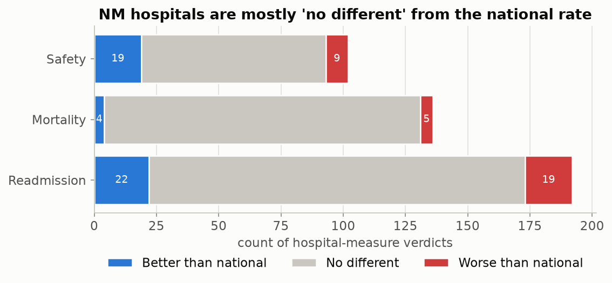
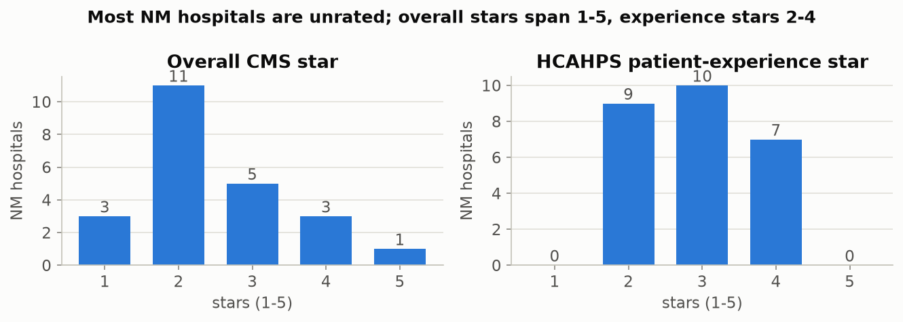
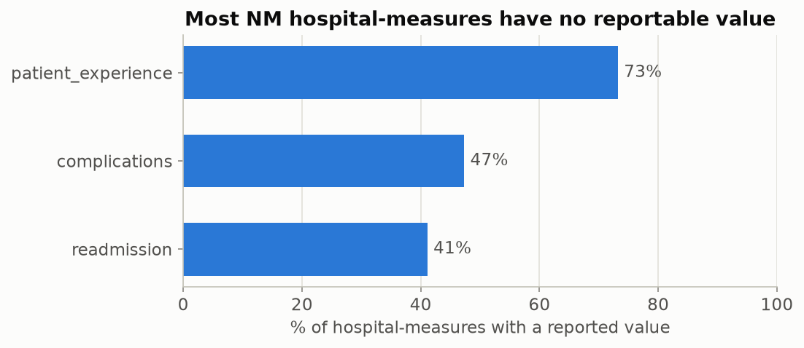
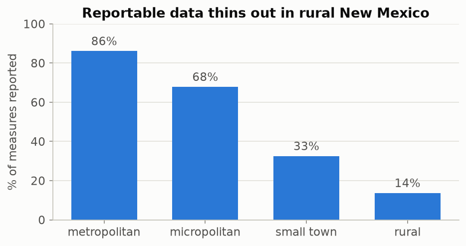
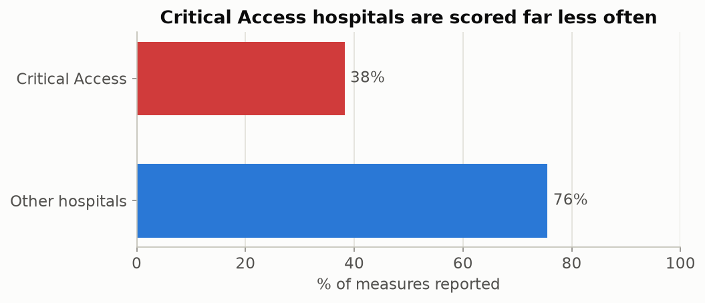
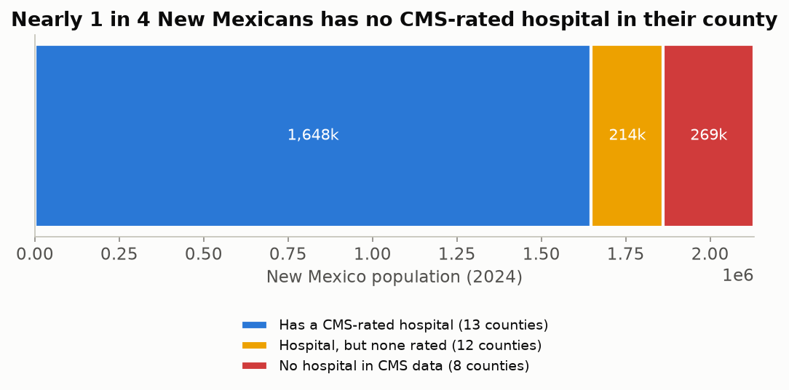
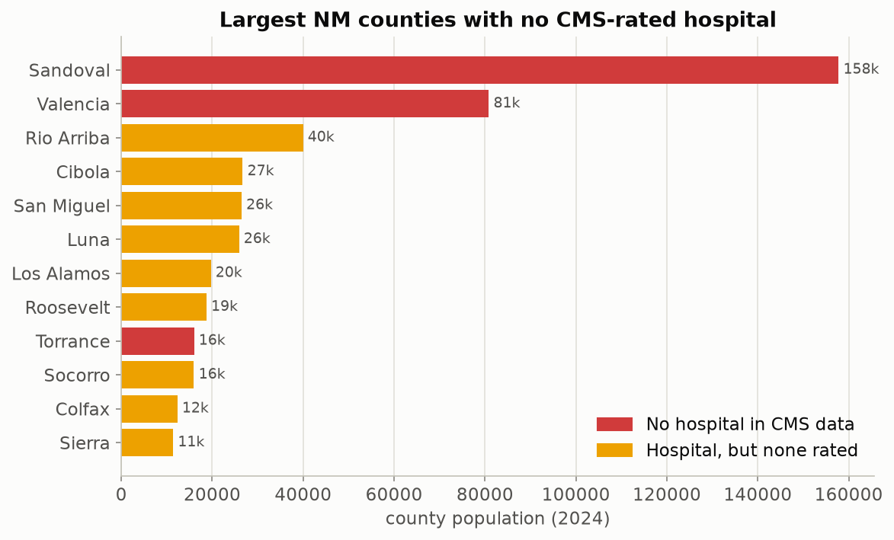
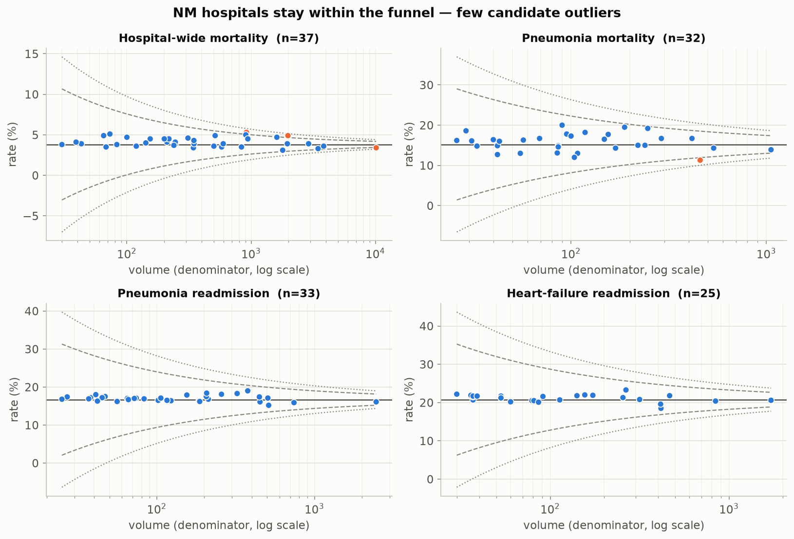
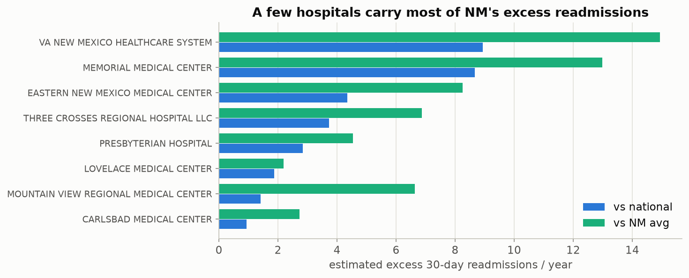
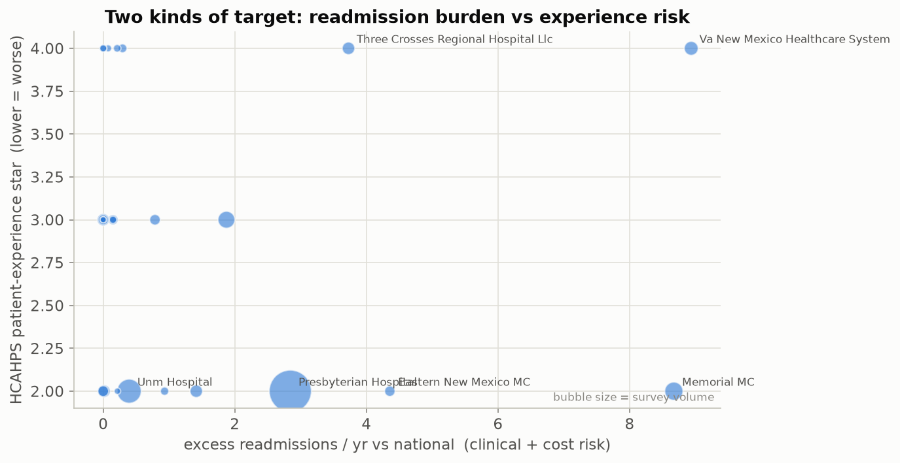

# NM Hospital Quality Scorecard — and who it leaves out

A reproducible analysis of hospital quality in New Mexico, built entirely from free, public
CMS, Census, and USDA data. Portfolio project by Ronald Tieu.

The project asks three questions:

1. **Scorecard** — how do NM hospitals perform on readmissions, complications/deaths, and
   patient experience?
2. **Coverage** — how much of New Mexico does the scorecard actually cover? Which hospitals,
   counties, and people have no reportable data, and is that gap concentrated in rural NM?
3. **Fair outliers** — which hospitals are true outliers once patient volume is accounted for
   (funnel plots), versus small hospitals that only look extreme by chance?

The answer isn't decided in advance; whatever the data shows is the finding.

## How the data was built (notebooks 01–02)

Seven public files (CMS hospital info, unplanned visits, complications/deaths, HCAHPS,
footnote crosswalk, USDA RUCA rural codes, Census county population) were filtered to New
Mexico and joined into analysis-ready tables.

- **45 NM hospitals** in the facility file; measure files cover fewer (small or Critical
  Access hospitals often have too few cases to report).
- **Facility ID kept as text** so leading zeros survive; it's the join key across all CMS files.
- **Missing values are never silently dropped.** "Not Available" / "Too Few to Report" become
  missing *with a decoded `missing_reason`*, because who the scorecard leaves out is the whole
  second question.

---

## Q1 — How do NM hospitals perform? (notebook 04)

Most CMS verdicts are **"no different than national."** NM hospitals rarely stand out either way.

*Per-measure "compared to national" counts (notebook 04).*

- Readmission: **22 Better / 151 No Different / 19 Worse**
- Mortality: **4 / 127 / 5** (the only domain where Worse edges out Better)
- Safety: **19 / 74 / 9**

Only **23 of 45 hospitals** have an overall star rating, and the ratings that exist cluster at
2–3 stars.

*Overall star ratings are sparse and bunched in the middle (notebook 04).*

---

## Q2 — How much of NM does the scorecard actually cover? (notebooks 03 & 07)

This is the finding most analyses miss. Coverage is thin, and it **tracks rurality**.

*Share of hospital-measure cells with a reported value: readmission 41%, complications 47%,
patient experience 73% (notebook 03).*

*Reporting falls off a cliff with rurality: 86% metro → 68% micropolitan → 33% small town →
14% rural (notebook 03).*

*Critical Access hospitals are scored on 38% of measures vs 76% for other hospitals, and only
3 of 13 have an overall star (notebook 03).*

### Who's actually behind the gap (notebook 07)

Joining 2024 Census population turns "missing hospitals" into "missing people."

*Of 2,130,256 New Mexicans: 77% live in a county with a CMS-rated hospital, 10% have a
hospital but none rated, 13% have no hospital in the CMS data (notebook 07).*

**~482,000 New Mexicans (~23%) live in a county with no CMS-rated hospital** — 269k across 8
counties with no hospital in the CMS data, 214k across 12 counties with only unrated hospitals.

*Largest counties with no CMS-rated hospital, by population. Sandoval (158k) and Valencia (81k)
lead and have zero CMS hospitals (notebook 07).*

> **Caveat:** a few "no hospital in CMS data" counties do have hospitals in reality (e.g.
> Sandoval / Rio Rancho's Presbyterian Rust Medical Center) that simply aren't in this CMS
> release. So the 23% is best read as "no CMS *quality signal*," not "no hospital exists."

---

## Q3 — Who are the true outliers? (notebook 05)

**No robust outliers.** Once volume is accounted for with funnel plots, **no** hospital falls
outside the 99.8% control limits on any of the 4 best-reported measures, and no hospital's CMS
95% interval excludes the NM average.

*Funnel plots: rate vs volume with 95% and 99.8% control limits. The few points past the 95%
line are consistent with chance given their small volume (notebook 05).*

Judging hospitals on raw rates alone would wrongly single these small hospitals out. This is the
honest answer: NM sits near the national rate, so there's no dramatic outlier story to tell.

---

## Where to act (notebook 06)

With no robust outliers, targeting shifts to **burden** (where excess concentrates), using two
separate dimensions.

### 1) Readmission burden

*Estimated excess 30-day readmissions/year, by hospital, under two benchmarks (notebook 06).*

- **~35 excess readmissions/year** above the national rate (~72 vs the NM average).
- At ~$15,500 each (AHRQ HCUP average cost), roughly **$0.5M–$1.2M/year** across the two
  benchmark scenarios. An estimate, not plan spend.
- **The top 3 hospitals carry 62% of the excess** (vs national): **VA New Mexico, Memorial
  Medical Center, Eastern New Mexico Medical Center.** (VA NM's is volume-driven, not a high
  rate.)

### 2) Patient-experience risk

A **different** list. Exposure = (5 − HCAHPS star) × completed surveys, so a low star at a big
hospital outranks a low star at a small one.

*Readmission excess (x) vs experience star (y), bubble size = survey volume (notebook 06).*

- **Presbyterian Hospital** (2★, 5,750 surveys), **UNM Hospital** (2★, 1,884), **Memorial
  Medical Center** (2★, 1,078) top the experience-exposure list.
- NM's biggest hospitals are its low-star ones, so a weak experience reaches the most patients.

No single hospital tops both lists, so the two tracks should stay separate.

---

## Recommendations

1. **Address coverage gap first**. Nearly 1 in 4 New Mexicans lives in a county with no CMS rated hospital, so CMS quality data can't see them. The plan should use its own claims data (internal records of what it pays for) to track readmissions and utilization in those counties, starting with the largest, Sandoval and Valencia.

2. **Target readmissions where the burden concentrates**. Focus on post discharge follow-up (follow-up calls, medication reconciliation, booked appointment) at the 3 hospitals carrying most of the excess readmissions, VA NM, Memorial, Eastern NM.

3. **Treat patient experiences as its own track**. Focus HCAHPS work (communication, clearer discharge information, staff responsiveness) at a high volume, low-star hospitals, like Presbyterian, UNM, and Memorial.

---

## Why these recommendations should help (findings + research)

This project shows where NM's excess readmissions are. 3 hospitals (VA NM, Memorial, Eastern NM) carry about 62% of the excess vs the national rate (notebook 06). It doesn't show why they happen, so the fix doesn't come from this data, it comes from research on post-discharge follow-up. That is what the recommendation leans on:

- Outpatient follow-up visits after discharge reduce 30-day readmissions for heart failure, COPD, heart attack, and stroke (systematic review and meta-analysis). [Outpatient follow-up visits to reduce 30-day all-cause readmissions](https://www.ncbi.nlm.nih.gov/pmc/articles/PMC11451567/)

- A discharge follow-up phone service lowered 30-day readmissions in a hospital evaluation. [Reducing readmission rates through a discharge follow-up service](https://pmc.ncbi.nlm.nih.gov/articles/PMC6616175/)

- Bigger programs and a randomized trial use the same actions recommended here (follow-up calls, medication reconciliation, a booked appointment) and see lower readmissions ([Kaiser Permanente Transitions Program](https://pmc.ncbi.nlm.nih.gov/articles/PMC8356037/), [TARGET-READ trial](https://www.ncbi.nlm.nih.gov/pmc/articles/PMC10048511/)).

Why this should help NM: those 3 hospitals hold most of the excess, and the excess sits in the conditions (heart failure, COPD, pneumonia) where follow-up has the strongest evidence. So putting post-discharge follow-up at those hospitals aims it right at the avoidable readmissions the analysis flagged. The effect would be a reduction, modest and not guaranteed. This project gives the where, and the research gives what works.

---

## Method & honesty notes

- Missingness is decoded to a reason, never silently dropped — *who the scorecard leaves out* is
  the core question.
- CMS readmission/mortality rates are risk-standardized model estimates, so binomial funnel limits
  are an approximation; the method was cross-checked against CMS's own interval estimates (notebook 05).
- Dollar figures use AHRQ HCUP cost per readmission (Statistical Brief #278, 2018) — a facility
  cost, not what a plan pays; treat as an order-of-magnitude estimate.
- The data shows *where* excess readmissions are, not *why*. Post discharge follow up is an
  evidence based suggestion, not a cause diagnosed from this data.

## Tools

Python (pandas), `uv` for the environment, Jupyter, matplotlib/seaborn for figures.
